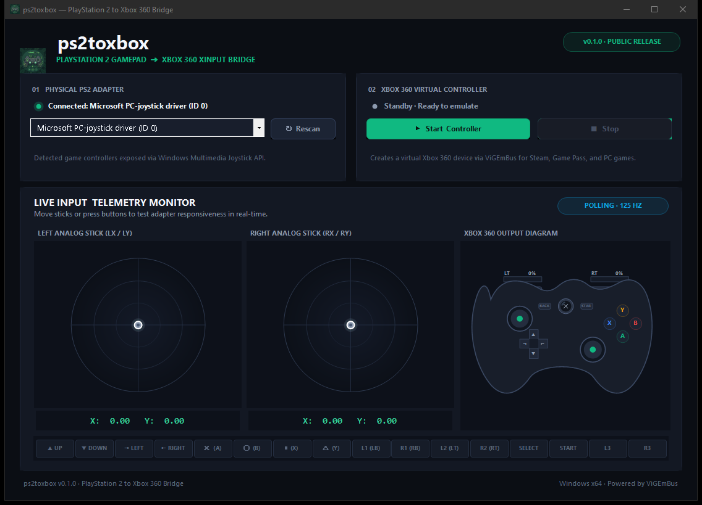

# ps2toxbox

<p align="center">
  
</p>

**ps2toxbox** converts a compatible PlayStation 2 gamepad adapter into an Xbox 360 XInput controller on Windows. It has a dark interface, live stick monitor, and an Xbox controller diagram that highlights the mapped output.

<p align="center">
  
</p>

## Compatibility

- Windows x64.
- **Windows 11 has not been tested yet. It may work**, provided ViGEmBus installs and the gamepad adapter is detected by Windows.
- A PS2-to-USB adapter exposed through the Windows Multimedia Joystick API.
- ViGEmBus installed and working. The driver is a separate prerequisite and is not included in the executable.

The app has been developed against the connected PS2 adapter. Support for other adapters can vary. Windows 11 compatibility is not confirmed.

## Download and run

The release build is a single `ps2toxbox.exe`: it bundles the logo and x64 `ViGEmClient.dll`. On first run, the app extracts the native client library into its per-build folder under `%LOCALAPPDATA%` so Windows can load it. ViGEmBus must already be installed. The app does not install drivers or change Windows boot settings.

## Build from source

On Windows with the .NET Framework C# compiler installed, run:

```powershell
./build.ps1
```

This creates `ps2toxbox.exe` in the project folder. The build inputs include `vendor/ViGEmClient.dll` and the logo/icon files under `assets/`; those files are embedded into the executable. To write to a different path/name, use:

```powershell
./build.ps1 -OutputName ps2toxbox-preview.exe
```

## Input mapping

The default button mapping follows the supplied x360ce profile: physical buttons 1–4 map to Xbox Y, B, A, X; 5–6 to LB/RB; 7–8 to LT/RT; 9–10 to Back/Start; and 11–12 to L3/R3. The POV hat maps to the D-pad. X/Y map to the left stick and Z/R map to the right stick, with vertical axes inverted.

Guided calibration, saved profiles, broader HID/GameInput support, and an installer are not implemented yet.

## Third-party notices

The bundled ViGEmClient library is distributed under the MIT License. See [THIRD-PARTY-NOTICES.md](THIRD-PARTY-NOTICES.md) for its copyright and license text.
